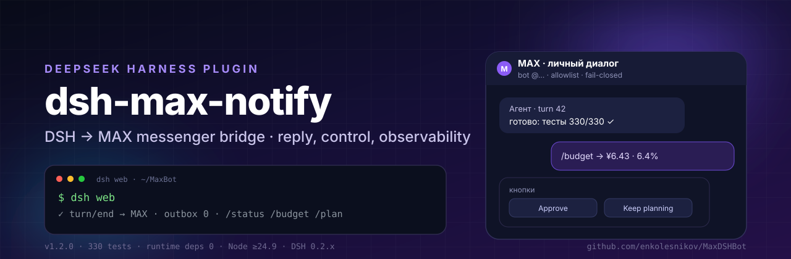
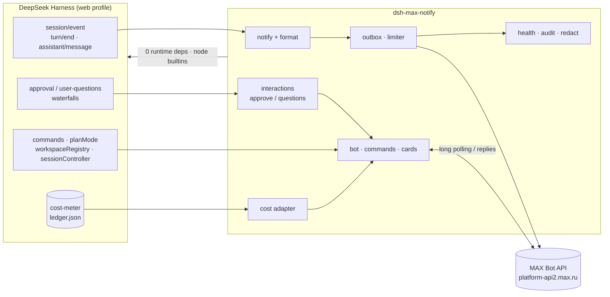

<div align="center">
  
</div>

<h1 align="center">dsh-max-notify</h1>

<p align="center">
  <b>Последний ответ агента — в MAX. Пульт управления, approvals, стоимость и наблюдаемость — оттуда же.</b><br/>
  Плагин для <a href="https://github.com/deepseek-ai/deepseek-harness">DeepSeek Harness</a> ·
  мессенджер <a href="https://max.ru">MAX</a> · ноль runtime-зависимостей
</p>

<p align="center">
  <a href="https://github.com/enkolesnikov/MaxDSHBot/actions/workflows/ci.yml"></a>
  <a href="https://www.npmjs.com/package/dsh-max-notify"></a>
  <a href="https://www.npmjs.com/package/dsh-max-notify"></a>
  <a href="https://github.com/enkolesnikov/MaxDSHBot/releases/latest"></a>
  <a href="LICENSE"></a>
  <a href="https://github.com/deepseek-ai/deepseek-harness"></a>
  <a href="https://max.ru"></a>
  
  <a href="https://nodejs.org"></a>
  
  <a href="https://github.com/enkolesnikov/MaxDSHBot/stargazers"></a>
</p>

<p align="center">
  <a href="#быстрый-старт">Быстрый старт</a> ·
  <a href="#что-умеет">Возможности</a> ·
  <a href="#команды-в-max">Команды</a> ·
  <a href="#архитектура">Архитектура</a> ·
  <a href="#конфигурация">Конфигурация</a> ·
  <a href="ROADMAP.md">Roadmap</a> ·
  <a href="dsh-max-notify/CHANGELOG.md">Changelog</a>
</p>

---

> [!NOTE]
> Плагин ставится в web-профиль DSH через `link:` и переживает перезагрузки:
> состояние (маркер polling, outbox, дедуп-ключи, health) лежит вне репозитория,
> в `$DSH_HOME/max-notify/`. Доступ — только по allowlist, интерактив
> fail-closed. Всё, что агент пишет, уходит на серверы MAX — для чувствительных
> сессий используйте `enabled: false` или `dryRun: true`.

## Что умеет

| | Возможность | Что даёт |
|---|---|---|
| 💬 | **Ответы агента** | Один MAX-месседж на ход (`turn/end`), чанкинг 4000 символов, картинки и файлы `present` вложениями, входящие файлы из MAX → `max-inbox/` |
| 🕹 | **Пульт** | Двусторонний чат, 25+ команд (`/status`, `/model`, `/plan`, `/sessions`, `/budget`…), инлайн-кнопки, live-прогресс |
| 🔐 | **Approvals** | Подтверждения и вопросы из MAX с гонкой MAX↔GUI, таймаутом, «запомнить для инструмента», audit-логом |
| 👀 | **Наблюдатель** | Subagent/job/goal/error, TODO-прогресс, режимы молчания, тихие часы, ежедневный дайджест |
| 🛡 | **Надёжность** | Durable outbox, at-least-once polling с дедупом, глобальный лимитер, health/heartbeat, redaction секретов |
| 💰 | **Стоимость** | Read-only интеграция с `dsh-cost-meter`: `/budget`, cost-строки в `/status` и дайджесте, алерты 80/100 % |

## Архитектура



Плагин не форкает DSH и не патчит ядро: он использует штатные швы
`session/event`, waterfall-события approvals/questions, `sessionController`,
`commands`, `planMode`, `workspaceRegistry` и read-only ledger `dsh-cost-meter`.

## Быстрый старт

### Установка из npm (рекомендуется)

```bash
dsh plugin --profile web add dsh-max-notify
```

### Из git-чекаута (для разработки)

```bash
git clone https://github.com/enkolesnikov/MaxDSHBot.git
cd MaxDSHBot

cp .env.example .env && chmod 600 .env   # MAX_BOT_TOKEN=..., MAX_CHAT_ID=...
node dsh-max-notify/tools/pair.mjs       # узнать chat_id: нажать Start в диалоге с ботом
node dsh-max-notify/tools/send-test.mjs "проверка"

./dsh-max-notify/install.sh              # профиль web (или: ./install.sh tui)
```

Оба способа добавляют пакет в `dsh.profile.bundles`, а его
`cordis.patch.yml` вставляет строку `max-notify`. Пакет:
[npmjs.com/package/dsh-max-notify](https://www.npmjs.com/package/dsh-max-notify).

<details>
<summary><b>Приватная конфигурация (не коммитить)</b></summary>

`botTokenFile` / `chatId` / `allowedUserIds` — в собственном
`$DSH_HOME/profiles/<p>/cordis.patch.yml`, как override строки с тем же `id`:

```yaml
- id: max-notify
  config:
    botTokenFile: /path/to/MaxDSHBot/.env
    chatId: 123456789
    allowedUserIds: [987654321]
```

Конфиг в override **заменяет объект целиком**. В репозитории нет ни токенов,
ни chat/user id.

</details>

## Команды в MAX

| Команда | Действие |
|---|---|
| `/status`, `/current` | Сессия, модель, папка, стоимость, бюджет |
| `/stop` | Остановить текущий ход |
| `/sessions`, `/use N` | Список сессий и переключение (включая холодные — с заголовками) |
| `/new [папка]` | Новая сессия (папка создаётся) |
| `/model [N\|provider/model]` | Каталог моделей и переключение |
| `/rename <название>`, `/fork`, `/compact` | Переименовать / ответвить / сжать историю |
| `/plan`, `/plan off`, `/plan status` | Режим плана; review плана приходит файлом `plan.md` с кнопками |
| `/search <текст>` | Поиск по содержимому сессий |
| `/archive`, `/pin`, `/unpin` | Архивировать текущую / закрепить / открепить |
| `/workspace [N\|add <path>]` | Рабочие папки; папка для следующих `/new` |
| `/approve` | Политика подтверждений `ask`/`never` (двухшаговое подтверждение) |
| `/mode`, `/mute`, `/unmute`, `/digest` | Режимы уведомлений, тишина, дайджест |
| `/budget`, `/cost` | Стоимость и бюджет из `dsh-cost-meter` |
| `/health`, `/version`, `/ping`, `/help` | Диагностика и справка |

Текст без `/` уходит агенту как следующее сообщение. Под финальным ответом —
кнопки «Продолжить», «Стоп», «Открыть GUI» и настраиваемые пресеты.

## Webhook (production-транспорт)

По умолчанию работает long polling. Для production можно включить webhook —
MAX будет сам присылать обновления на публичный HTTPS-эндпоинт:

```yaml
- id: max-notify
  config:
    transport: webhook
    webhookPath: /max/webhook
    webhookPublicUrl: https://example.com/max/webhook
    webhookSecret: ${MAX_NOTIFY_WEBHOOK_SECRET}   # 5–256 символов [A-Za-z0-9_-]
    webhookAutoSubscribe: true
```

1. `webServer.register` добавляет точный маршрут в уже работающий DSH HTTP-сервер
   (nginx с Let's Encrypt терминирует 443 и проксирует на DSH).
2. MAX проверяет TLS-цепочку, домен и secret-заголовок; каждое обновление
   сначала сохраняется в durable-очередь `state.json`, потом отвечаем `200`.
3. Обработка идемпотентная (общий dedupe с polling), при сбое — `503`, MAX
   повторит; после 8 часов неудач отписка автоматическая.
4. Подписка управляется автоматически (`GET/POST /subscriptions`), вручную:
   `node tools/webhook.mjs status|subscribe|unsubscribe --env ../.env`.

Если webServer/secret/public URL не сконфигурированы, плагин откатывается на
long polling и пишет warning в лог. Официальная документация MAX:
[webhooks](https://dev.max.ru/docs-api/methods/POST/subscriptions).

## Reply-ветки, таблицы, расписания (v1.0)

- **Reply-ветки**: первый ответ сессии становится якорем, следующие приходят
  реплаями к нему; ответ пользователя на любой ответ уходит в исходную сессию.
  Якоря/mid→session переживают reload.
- **Таблицы → файлы**: markdown-таблицы дополнительно уходят как `table-N.csv`
  и `table-N.md`, текст ответа заменяется плейсхолдером (MAX не рендерит таблицы).
- **`/schedules`**: список задач, `pause`/`resume N`, `cancel N` с подтверждением.
- **Forwarded-сообщения** из MAX разворачиваются и передаются агенту.
- **`/settings`**: снимок эффективных настроек (transport, режим, allowlist,
  таймауты, фичи) без секретов.
- Полный GUI-редактор настроек, голос и нативные входящие изображения — в 1.1.

## Надёжность и безопасность

- **Durable outbox** — финальные ответы и уведомления переживают недоступность MAX и reload; retry с backoff, TTL, приоритеты, дедуп по `session:turn:seq`.
- **At-least-once polling** — marker сдвигается после обработки; обработанные update-id сохраняются, повторная доставка не дублирует промпты.
- **Лимитер** — 2 запроса/с на чат, 30/с суммарно; approvals/ошибки идут critical-каналом.
- **Fail-closed** — без `allowedUserIds`/`allowedChatIds` команды, approvals и polling выключены; уведомления работают. `allowUnlistedUsers: true` — осознанный escape.
- **Approvals** — таймаут 120 с, «запомнить» только для явного `approvalRememberTools`, audit `$DSH_HOME/max-notify/audit.jsonl` (0600).
- **Health/redaction** — `/health`, heartbeat-файл, redaction токенов в логах, rate-limit входящих.

## Конфигурация

<details>
<summary><b>Все ключи (cordis.patch.yml / override профиля)</b></summary>

| Ключ | По умолчанию | Смысл |
|---|---|---|
| `botToken` / `botTokenFile` | env `MAX_BOT_TOKEN` | токен бота или файл с `MAX_BOT_TOKEN=...` |
| `chatId` / `userId` | env `MAX_CHAT_ID` | получатель (чат/диалог или user_id) |
| `format` | `markdown` | `markdown` / `html` / текст |
| `notify` | `true` | push-уведомления |
| `disableLinkPreview` | `true` | отправляется **query-параметром** (требование MAX) |
| `includeHeader` / `includeTitle` / `includeSessionId` | `true` / `true` / `false` | заголовок сообщения и сессии |
| `includeSubagents` | `false` | пересылать и дочерние агент-сессии |
| `allowedUserIds` / `allowedChatIds` | env `MAX_ALLOWED_USER_IDS` / `..._CHAT_IDS` | allowlist получателя, fail-closed |
| `skipReasons` | `[interrupted, forked]` | окончания хода, которые не пересылаются |
| `maxChars` | `3800` | предохранитель (жёсткий лимит API — 4000) |
| `enabled` / `dryRun` | `true` / `false` | выключатель / только лог |
| `requestTimeoutMs` / `maxRetries` / `minIntervalMs` | `15000` / `3` / `600` | транспорт |
| `notifyOnStart` | `false` | одноразовое «плагин подключён» в MAX |
| `polling` / `pollTimeoutSec` | `true` / `25` | long polling `GET /updates` (один поллер на токен) |
| `interactive` | `true` | приём сообщений/кнопок и команды |
| `approvalChannel` / `questionChannel` | `both` | `both` (MAX + GUI гонка), `max`, `gui` |
| `buttons` / `buttonsPresets` / `webUrl` | `true` / `[]` / env `DSH_WEB_URL` | кнопки, пресеты, ссылка на GUI |
| `progress` / `progressDelayMs` / `progressThrottleMs` / `typing` | `true` / `2500` / `2000` / `true` | live-карточка прогресса |
| `deliverables` | `true` | отправлять файлы из `present` вложениями |
| `forwardImages` / `forwardToolImages` / `maxImages` | `true` / `true` / `4` | картинки из ответа и tool-результатов |
| `receiveFiles` / `inboxDir` | `true` / `<cwd>/max-inbox` | приём файлов из MAX |
| `maxIncomingFiles` / `maxIncomingBytes` | `4` / `25 MiB` | лимиты входящих |
| `registerCommands` / `greetOnStart` | `true` / `true` | меню команд MAX и приветствие по Start |
| `newSessionDir` | — | папка для `/new` (по умолчанию — папка активной сессии) |
| `notifySubagents` / `notifyJobs` / `notifyGoals` / `notifyErrors` | `true` | уведомления о событиях |
| `todoProgress` | `true` | TODO-прогресс в MAX |
| `quietHours` | — | `{start: '23:00', end: '08:00'}` — без push ночью |
| `digestEnabled` / `digestTime` | `false` / `21:00` | ежедневный дайджест |
| `mode` | `all` | стартовый режим: `all`, `errors`, `mute` |
| `stateFile` | `$DSH_HOME/max-notify/state.json` | marker, сессии, health, dedupe-ключи |
| `outboxEnabled` / `outboxMaxItems` / `outboxTtlHours` | `true` / `200` / `48` | durable-очередь |
| `ratePerChatPerSecond` / `rateGlobalPerSecond` | `2` / `30` | глобальный лимитер |
| `approvalTimeoutMs` | `120000` | таймаут approvals, `0` — ждать бесконечно |
| `approvalRememberTools` / `approvalRememberMs` | `[]` / `3600000` | «запомнить» только для явных инструментов |
| `allowUnlistedUsers` | `false` | интерактив без allowlist (небезопасно) |
| `incomingPerMinute` / `incomingBurst` | `30` / `10` | защита от флуда |
| `auditLog` / `auditFile` | `true` / `$DSH_HOME/max-notify/audit.jsonl` | аудит решений |
| `heartbeatFile` | — | JSON здоровья для мониторинга |
| `costMeterEnabled` / `costMeterFile` | `true` / `$DSH_HOME/storages/cost-meter/ledger.json` | read-only адаптер стоимости |
| `budgetAlertEnabled` / `budgetAlertThresholds` | `true` / `[80, 100]` | алерты бюджета (раз за период) |
| `transport` | `polling` | `polling` или `webhook` |
| `webhookPath` / `webhookPublicUrl` | `/max/webhook` / — | маршрут и публичный HTTPS URL |
| `webhookSecret` | env `MAX_NOTIFY_WEBHOOK_SECRET` | secret-заголовок MAX (обязателен для webhook) |
| `webhookUpdateTypes` | message_created,… | список типов обновлений для подписки |
| `webhookAutoSubscribe` / `webhookRemoveOnStop` | `true` / `false` | авто-подписка/отписка MAX |
| `webhookQueueMax` | `200` | durable-очередь входящих webhook-обновлений |
| `threads` | `true` | reply-ветки сессий (якорь + маршрутизация ответов) |
| `tableFiles` / `tableMaxFiles` | `true` / `4` | markdown-таблицы → CSV/MD файлами |

</details>

## Структура

<details>
<summary><b>Файлы плагина</b></summary>

| Путь | Что это |
|---|---|
| `dsh-max-notify/index.js` | cordis-плагин: конфиг, проводка, сессии, дедуп финала |
| `lib/transport.mjs` | MAX Bot API на `node:https` + встроенный Russian Trusted CA |
| `lib/bot.mjs` | long polling, команды, маршрутизация, flood protection |
| `lib/interactions.mjs` | approvals/questions, план-review, гонка MAX↔GUI |
| `lib/progress.mjs` | live-карточка и typing |
| `lib/deliverables.mjs`, `lib/incoming.mjs` | файлы в обе стороны |
| `lib/outbox.mjs`, `lib/limits.mjs` | durable-очередь и лимитер |
| `lib/state.mjs`, `lib/health.mjs`, `lib/audit.mjs`, `lib/redact.mjs` | состояние, health, аудит, секреты |
| `lib/cost-meter.mjs` | read-only ledger `dsh-cost-meter` |
| `lib/webhook.mjs` | webhook-обработчик, secret, подписка MAX |
| `lib/tables.mjs` | markdown-таблицы → CSV/MD |
| `lib/schedules.mjs` | `/schedules`: список, пауза, удаление |
| `lib/observer.mjs`, `lib/policy.mjs` | события, дайджест, режимы, алерты бюджета |
| `certs/ca-chain.pem` | Russian Trusted Sub CA + Root CA |
| `test/` | 187 тестов (`node --test`) |
| `tools/` | `pair.mjs`, `send-test.mjs`, `smoke.mjs`, `webhook.mjs` |

</details>

## Ограничения

<details>
<summary><b>Что важно знать</b></summary>

- Пересылается только финальный текст хода, не стрим и не tool-шаги.
- MAX markdown не поддерживает списки/таблицы: `- пункт` отрисуется текстом.
- Fail-closed: без allowlist интерактив выключен (уведомления идут). `allowUnlistedUsers: true` открывает бота всем, кто знает чат.
- Long polling — **один поллер на токен**; `tools/pair.mjs` конкурирует с плагином за события. Webhook — в roadmap 0.9 (MAX требует публичный HTTPS :443; nginx с Let's Encrypt готов).
- Approvals по умолчанию истекают через 120 с; `approvalTimeoutMs: 0` — ждать бесконечно.
- Outbox гарантирует **at-least-once**: редкий повтор возможен при сбое между отправкой и записью ключа; типовые reload/батч закрыты дедупом.
- Один `chatId` на строку `max-notify`; для нескольких получателей — отдельные профили/патчи.
- Бюджет и алерты работают только когда Budget включён в настройках `dsh-cost-meter`.

</details>

## Проверка

```bash
cd dsh-max-notify && npm test          # 249 unit tests
npm run check                          # синтаксис всех модулей
node tools/smoke.mjs --env ../.env     # read-only: GET /me, state, outbox
node tools/send-test.mjs "проверка"    # реальная отправка
```

TLS-цепочка проверена `openssl verify` (leaf → Russian Trusted Sub CA → Root CA);
живая отправка — HTTP 200 с `mid`, markdown-разбор подтверждён `GET /messages`.

## Документация

- [ROADMAP.md](ROADMAP.md) — план 0.9 → 1.0.
- [CHANGELOG.md](dsh-max-notify/CHANGELOG.md) — история версий.
- [SECURITY.md](SECURITY.md) — секреты, allowlist, аудит.
- [research/](research/) — устройство DSH-плагинов, MAX Bot API, каталог фич.
- [dsh-max-notify/README.md](dsh-max-notify/README.md) — справка по пакету (EN).

## Лицензия

MIT — см. [LICENSE](LICENSE).
